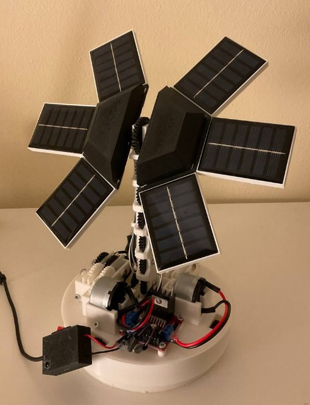
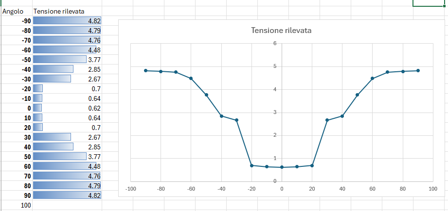
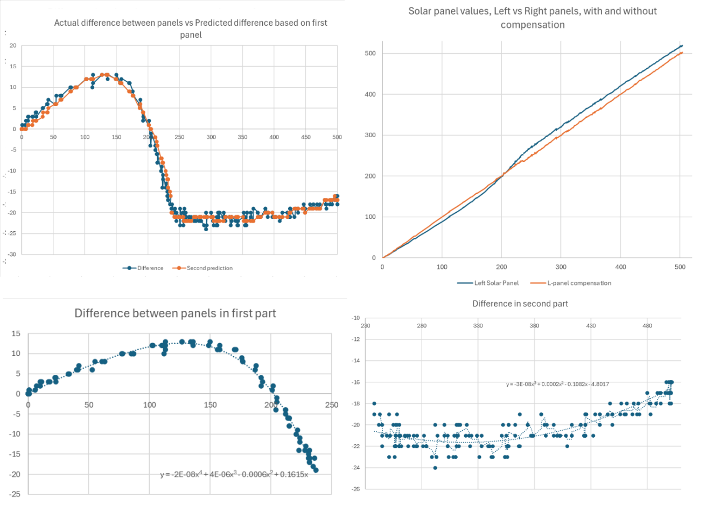
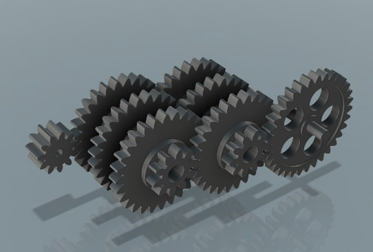
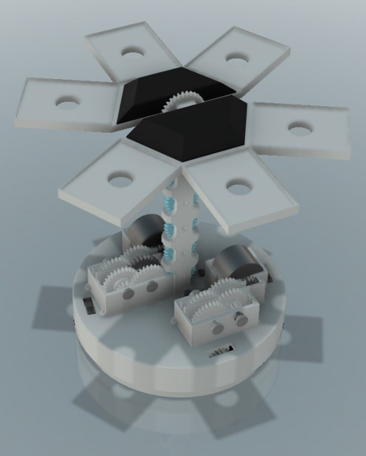

Turns a set of solar panels towards the brightest light on two axes, with a printed gearbox and a controller that needs no setpoint.

| Result | Value |
| --- | --- |
| Tracking, from two starting orientations | finds the brighter direction and stops when the reading drops, on both axes |
| Sensor noise after the 8-sample moving average | about plus or minus 1 ADC count |

[](https://www.arduino.cc/)
[](https://isocpp.org/)
[](https://www.autodesk.com/products/fusion-360/)
[](https://openscad.org/)
[](https://store.arduino.cc/products/arduino-nano)
[](https://www.st.com/en/motor-drivers/l298.html)
[](report/report.pdf)
[](cad/sunflower_robot.stl)
[](LICENSE)



*The completed Sunflower robot: six panels as petals on a printed pistil, two printed gearboxes, and an L298N-driven pair of 12 V motors on a rotating base.*

## Abstract

The objective was a two-axis solar tracker built almost entirely from parts already in storage and from 3D-printed mechanics, able to point an array of small solar panels at the brightest light source in the room. The approach combined a characterisation of the light sensor, a custom high-ratio spur gearbox generated in OpenSCAD with the BOSL2 library, a printed body designed in Autodesk Fusion, and a closed-loop tracking algorithm that climbs the gradient of the measured luminosity and needs no fixed reference. The final build tracks on both axes. It detects the direction of increasing intensity, drives towards it, and stops and backs up as soon as the intensity drops.

## Problem

The task is to point an array of panels at the brightest source in the room, with a sensor that has three faults.

A photoresistor is non-linear. Its measured resistance in this build spans 38 kOhm down to 132 Ohm, and the divider voltage it produces saturates away from the peak and flattens near it. It has a hysteresis cycle. At low luminosity its uncertainty is large enough to swamp the quantity being measured. A small solar panel is no better behaved, and no two panels out of the same pack are matched.

There is also no reference value. The controller is chasing an unknown maximum that moves, so there is nothing to subtract a measurement from and call an error.

The mechanical half of the problem is torque. The DC motors already in storage are rated 1.5 V to 6 V and spin at 20,000 RPM with no load, producing almost nothing at the low speeds needed to point a panel array precisely. A large reduction is mandatory, and built from printed plastic it brings friction, backlash and wear, all set by the printer.

## Motivation

Every real tracker solves the same two problems at a larger scale. It has to find a maximum it cannot measure directly, and its drive train has to hold a position against its own slop.

PID was considered first and discarded, because a PID needs a setpoint and light tracking offers none. The objective is to maximise an unknown, drifting quantity. The sensor characterisation showed a signal with no fixed reference value but with a well-defined maximum, and an extremum seeker works on such a signal. It drives the axis while the reading improves, then stops and backs up when the reading stops improving. The same rule works unchanged on the up-and-down axis and on the rotation axis.

In this build the constraints of the printer reach down to the controller. Nozzle diameter sets the minimum tooth size and first-layer squash sets the minimum gear width. Together they determine the friction, which fixes the minimum PWM duty cycle the controller is allowed to use.

## Approach

**Sensor characterisation.** A photoresistor (38 kOhm to 132 Ohm measured) was placed in a voltage divider across 5 V, with an Arduino ADC on the midpoint. A torch was swept over a protractor printed on an A4 sheet and the divider voltage recorded at known angles. The divider voltage is low where the light is strongest, confirming the inverse relation, and the curve saturates away from the peak. That single measurement fixed the form of the control law.

**Panels as the sensor.** The panels are rated 3 V and 0.3 W, 65 x 48 mm, in a pack of six. Panel voltage is proportional to incident light, so the panels themselves become the sensor and no separate photoresistor is needed in the final build. Against the artificial sources available they reached up to 3.6 V at maximum luminosity. Six of them allow a petal layout, which puts panels in opposite positions so that the difference between two of them can carry directional information.

**Gearbox.** Gears were generated in OpenSCAD with BOSL2. The Fusion gear toolkit could not hit the bore diameters, tooth counts and pitch diameters the design required at the same time, because the bores had to match parts already owned while the pitch diameters were dictated by the reduction ratio and the available space. Everything is printed in PETG on a modified Ender 3 (0.2 mm nozzle, 220 x 220 x 250 mm build volume), with gearbox outer walls held to at least 2.5 mm.

**Body.** Designed in Autodesk Fusion. Vertical rotation comes from a column of seven gears on a split main axis. Horizontal rotation puts the whole flower on a bearing locked to a lower base, driven by the second gearbox through a cut in the upper base. The shafts are recovered IKEA spare parts, including a stainless steel pair used as the gearbox main axis and a wooden rod as the pistil axis.

**Electronics.** Arduino Nano V3, L298N dual H-bridge, two 12 V DC motors, supply built from a modified laptop adapter. Four panels in series feed one low-pass filter, a divider, and a single ADC pin.

**Control.** Gradient ascent on filtered luminosity. Each ADC sample enters an 8-sample moving average, which holds residual noise at roughly plus or minus 1 count. The search drives an axis and keeps sampling. A drop of more than 3 counts below the best value seen during that movement is the stop condition, and the axis then backs up towards the best position. Tracking re-triggers whenever the reading falls below 93 % of the running maximum. Every wait in the firmware is a loop that keeps sampling, so the controller never acts on a stale reading.

The moving average, verbatim from [`firmware/Sunflower_project_V5.ino`](firmware/Sunflower_project_V5.ino):

```cpp
int get_averageRead(int pin) {
  float newReading = analogRead(pin);
  total = total - readings[index];   // Subtract the oldest reading from the total
  readings[index] = newReading;      // Add the new reading to the array
  total = total + readings[index];   // Add the new reading to the total
  index = (index + 1) % numReadings; // Move to the next position in the array
  average = float(total) / numReadings;
  return round(average);
}
```

## Results

Placed in two different orientations with respect to the light source, the robot identifies the direction of higher intensity, drives towards it, and stops as soon as the intensity starts dropping, on the vertical axis and on the horizontal one.

These are the measurements behind this result:

| Quantity | Value |
| --- | --- |
| Photoresistor resistance range | 38 kOhm to 132 Ohm, in a 5 V divider |
| Panel output at maximum luminosity | up to 3.6 V (rated 3 V, 0.3 W, 65 x 48 mm) |
| First gearbox reduction ratio | about 638, which stalled the 6 V motors |
| Vertical axis | column of seven gears, 180 degrees of pistil travel |
| Backlash correction | vertical gears scaled up by 1 % or less |
| Passive low-pass cutoff | about 16 Hz, chosen to keep added delay under 10 ms |
| Moving average | 8 samples, residual noise about plus or minus 1 count |
| Search dead band | 3 counts below the running best |
| Re-trigger threshold | 93 % of the running maximum |
| PWM duty cycle | 28 % minimum vertical, 35 % minimum horizontal, 50 % maximum |
| Initial maximum | 455 ADC counts, measured with a 360-degree sweep |
| Calibration set | 773 clean samples per panel |



*Photoresistor divider voltage against torch angle. The response saturates away from the peak and is far from linear, which is what rules out a setpoint and admits an extremum seeker.*



*Panel compensation from the 773-sample calibration set. Modelling panel voltage directly against lux needed a polynomial degree the Arduino could not sustain; modelling the difference between the panels, split in two at a luminosity threshold and fitted with two polynomial regressions, worked.*



*Interior of the first gearbox, ratio about 638. It turned by finger and would not move under the 6 V motor.*



*The final mechanical design, shown without the electrical components and the panels.*

## Discussion

Two failures decided the final design.

**The first gearbox stalled the motors.** The optimistic first design reached a reduction of about 638, and its friction and tight tolerances were high enough that the 6 V motor could not break it loose. Driven at 12 V on a bench supply, at the maximum available current, it overheated and fumed without ever starting. The gearbox itself turned by finger, so the train was free and the fault was friction. Silicon lubricant between the gears, the walls and the axes was insufficient. That result forced three changes at once: 12 V motors in place of the 6 V hobby-kit ones, fewer and larger gears (a larger root diameter keeps a comparable ratio with a lower gear count), and rings added to the inner walls to cut the contact area between the gears and the housing. A second gearbox with only the friction fixes still failed to run, which proved that the motor change was necessary.

**A soldering fault killed the differential sensing scheme.** After the circuit was moved off the breadboard into a permanent soldered build, the panel signals came back scaled or offset, and would not stay consistent between calibration runs. Repeated cycles of acquiring data, fitting a compensation and testing failed to converge. Two additive causes were found. One filter capacitor had been destroyed by heat during soldering, which was invisible through an ADC and a serial plotter and could only be inferred. Under lab illumination far brighter than anything available at home, one panel then visibly charged and discharged like a capacitor, adding a voltage term unrelated to the instantaneous light. Disassembling the robot to rewire the panels would have cost more than the remaining budget, so the two-panel differential scheme was dropped and the four unused panels, already wired in series to the board, were routed through a fresh low-pass filter and divider into an ADC port that had never been used. The result is one aggregated luminosity channel with no directional information.

**PID was rejected on the sensor characterisation, before any of that.** There is no fixed setpoint to regulate against, so the error signal a PID needs does not exist. Gradient ascent needs only a comparison between two consecutive readings, and that comparison is the only reliable output of this sensor.

## Limitations

The differential scheme was abandoned for hardware reasons. It had already been validated on the vertical axis of the prototype, and the compensation of the panel difference worked. It was dropped because of a cooked capacitor and a capacitive panel, and the scheme itself had no defect.

The final build therefore has no directional awareness. The single aggregated channel says whether the last movement improved things, so the robot has to try a direction to learn whether it was right.

The control signal is noisy. The passive filters were removed after the capacitor failure and only software filtering remains.

The vertical gear slips. Wear on the inner bore of the pistil gear lets the axis slip during up and down rotations, and the replacement gear was never reprinted.

The firmware is frozen, because the programmer module of the soldered Arduino failed and ended algorithm iteration.

The parametric CAD source is not in this repository. The model can be printed as it is. It cannot be re-parameterised, so changing the shafts, the bearing or the motors means regenerating the gears in OpenSCAD with BOSL2 and redrawing the housings.

No charging module was fitted. The panels produce power and nothing stores it.

## Build and run

**Bill of materials**

| Item | Detail |
| --- | --- |
| Controller | Arduino Nano V3 (an Uno works for prototyping) |
| Motor driver | L298N dual H-bridge |
| Motors | 2 x 12 V DC |
| Panels | 6 x 3 V, 0.3 W, 65 x 48 mm |
| Sensor | 4 panels in series, low-pass filter, voltage divider, into one ADC pin (A4) |
| Reference sensor | Photoresistor, used only for calibration |
| Body | 3D-printed PETG, shafts recovered from IKEA spare parts |
| Supply | 12 V, from a modified laptop adapter |

**Firmware**

- [`firmware/Sunflower_project_V5.ino`](firmware/Sunflower_project_V5.ino) is the sketch that ships on the robot: the moving average, the gradient-ascent search, and the PWM limits for each axis. Open it in the Arduino IDE, select the Nano board, flash it. Motor pins are 9 and 6 for the vertical axis and 5 and 3 for the horizontal axis, into the L298N inputs. The sensor pin is A4.
- [`firmware/filter_lib.h`](firmware/filter_lib.h) is the digital first-order low-pass that replaced the hardware filter. It discretises the filter by bilinear transform and recomputes its coefficients from the sampling interval measured with `micros()`, so it stays correct even though the loop does not sample at a fixed rate.

**Printing**

- [`cad/sunflower_robot.stl`](cad/sunflower_robot.stl) is the printable mesh.
- [`cad/sunflower_robot.3mf`](cad/sunflower_robot.3mf) is the print-ready project.
- Material is PETG, chosen for mechanical strength and low cost, on a modified Ender 3 with a 0.2 mm nozzle and a 220 x 220 x 250 mm build volume. Gearbox outer walls are 2.5 mm or thicker.
- The parametric CAD source is absent. Print as is, or regenerate the gears yourself.

## Report, data and citation

The full engineering report, with the sensor characterisation, the gearbox iterations, the calibration experiments and the control algorithm, is [`report/report.pdf`](report/report.pdf).

There is no dataset. The calibration data (773 samples per panel) was acquired for this build and is described in the report.

The design is original. The two external tools it depends on are the [BOSL2](https://github.com/BelfrySCAD/BOSL2) library for OpenSCAD, which generated every gear in the final build, and [Marlin](https://github.com/MarlinFirmware/Marlin), the firmware running on the printer.

Licensed under the [MIT License](LICENSE).

```bibtex
@misc{mihailescu_sunflower,
  author = {Mihailescu, Alexandru},
  title  = {Sunflower: A Two-Axis Solar Tracker},
  howpublished = {\url{https://github.com/artaeun/sunflower-solar-tracker}},
  note   = {Arduino firmware, printable CAD, and engineering report}
}
```
